<p align="center">
  
</p>

<p align="center">
  
  
  
</p>

# jobfeed

Run one command and get Excel files of fresh jobs, each with a direct **Apply** link:

- **Daily jobs:** SDE-1 / Software Engineer / Frontend jobs **posted in the last 7 days** in tier-1 Indian cities
  (Bengaluru, Hyderabad, Pune, Mumbai, Delhi NCR, Chennai, Kolkata, Ahmedabad, remote India),
  from the public job boards companies publish themselves (Greenhouse, Lever, Ashby).
- **Companies hiring remotely:** companies from arc.dev plus remote dev jobs from Remotive, RemoteOK, Jobicy,
  Himalayas and Arbeitnow, one Excel file per platform.

## Install
Needs [Node.js](https://nodejs.org) 18 or newer.
```bash
npm install -g jobfeed
```
Or run it without installing: `npx jobfeed`

## Usage
```bash
jobfeed
```
1. Pick what to fetch: `1` daily jobs, `2` companies hiring remotely, `3` all. Press **Enter** for all.
2. Type or paste the folder to save into. Press **Enter** for the current folder.

All Excel files are written to a new folder named `jobfeed_<today's date>` inside that location:
```
jobfeed_2026-10-27/
  india_jobs_2026-10-27.xlsx
  remote_companies_2026-10-27.xlsx
  remotive_jobs_2026-10-27.xlsx
  remoteok_jobs_2026-10-27.xlsx
  jobicy_jobs_2026-10-27.xlsx
  himalayas_jobs_2026-10-27.xlsx
  arbeitnow_jobs_2026-10-27.xlsx
```
The companies crawl visits every arc.dev company profile, so option 2 takes a few minutes; option 1 takes seconds.

## Features
- **Fresh jobs only:** anything posted more than 7 days ago is dropped.
- **Entry-level filter:** Senior, Lead, Staff, SDE-2/3 and intern roles are removed automatically.
- **Excel output:** tidy sheets with company, title, location, posting date and a clickable Apply link.
- **Fast:** 80+ company boards are checked in parallel.

## Development
```bash
git clone https://github.com/Ashukr321/jobfeed && cd jobfeed
npm install
npm start      # run the CLI from source
npm test       # filter checks
```

### Release a new version
```bash
npm test
npm version patch     # bumps package.json version and makes a git tag
git push --follow-tags
npm publish
```
The first time, log in with `npm login`. Check what will be published with `npm pack --dry-run`.

### Add more companies
Each line of `companies.txt` is one company. Take the board name from the company's careers page URL:

| Careers URL | Line to add |
|---|---|
| `boards.greenhouse.io/groww` | `greenhouse:groww \| Groww` |
| `jobs.lever.co/meesho` | `lever:meesho \| Meesho` |
| `jobs.ashbyhq.com/acme` | `ashby:acme \| Acme` |

The `| Name` part is optional; it's the company name shown in Excel.

### Customize
Filters are at the top of `lib/daily.js`: `ROLE` (titles to include), `TOO_SENIOR` (titles to exclude),
`CITIES` and `MAX_AGE_DAYS` (default 7). Run `npm test` after changing them.

## Project layout
```
bin/jobfeed.js    the CLI
lib/daily.js      daily India jobs (Greenhouse, Lever, Ashby)
lib/remote.js     companies hiring remotely + remote job APIs
companies.txt     company boards to check
test.js           filter checks
assets/           README banner
```
